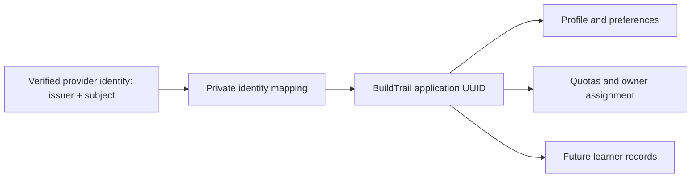

# Portable application identity and provider adapters

Status: approved by the user for implementation. This decision supersedes the identity ownership, bootstrap, provider-deletion cascade, and direct SDK coupling portions of the frozen implementation baseline and section-1 decision. PostgreSQL remains the selected database. Supabase remains the first authentication/Data API adapter; moving providers still requires migration and verification.

## Stable application identity

`private.app_users.id` is a generated application UUID. Profiles, preferences, quotas and the platform owner reference this identity, never `auth.users`. Creating an application user atomically bootstraps its profile and quota. Future enrollments and learner records must also reference application UUIDs. `/api/v1/me.userId` is this application UUID, not the provider's subject. There is no deployed consumer or production data to migrate in the current section.

`private.auth_identities` maps `(provider, issuer, subject)` to an application user. The composite primary key prevents one provider identity from addressing two application accounts. Multiple explicitly linked identities can address one application account. The application-user index supports cleanup and recovery. Provider, issuer and subject are exact, case-sensitive values; no email matching, metadata-based linking, account-state promotion or first-signup ownership is allowed. Mapping rows are private, with no browser reads or writes.

## PostgreSQL core

Canonical core statements live in `database/migrations/core`. They use ordinary PostgreSQL features: UUIDs, foreign keys, PL/pgSQL, grants, triggers and RLS. The core knows nothing about Supabase schemas, SDKs or roles. It creates a restricted `buildtrail_user` NOLOGIN role; unsafe pre-existing role capabilities cause migration failure. Database operators need permission to create/manage this role.

`private.current_app_user_id()` is the adapter hook. Its core implementation returns NULL. Core RLS and `private.read_account_context()` consequently deny access until a provider adapter is installed and correctly configured. The account reader derives its actor from this hook, never an HTTP-supplied app UUID. It returns the existing strictly validated account DTO. Missing mapping/profile/quota and inactive accounts fail closed. Fixed empty function search paths and explicit privileges remain required.

## Supabase adapter

Canonical Supabase statements live in `database/migrations/providers/supabase`. Only this layer references `auth.users`, `auth.uid()`, `auth.jwt()`, and Supabase roles. It grants the restricted core role to `authenticated`, revokes inherited/default broad table/function capabilities, and grants only the intended public RPC. Ordinary requests retain their public project key and user bearer; no administrative key is introduced into the server.

The trusted, singleton `private.supabase_auth_config` stores the issuer for this installation. Migrations intentionally leave it empty. Unconfigured signups fail with SQLSTATE 42501. Trusted local setup derives the issuer from CLI status as `<API origin>/auth/v1`, refuses an existing different issuer, and provisions any pre-existing Auth identities in the same setup transaction. Hosted setup must explicitly configure the correct issuer before opening signup and perform equivalent backfill as a trusted operator. Custom issuer arrangements are not supported by the current server configuration.

The resolver requires the JWT issuer to equal that trusted configuration and finds the exact `(supabase, issuer, auth.uid())` mapping. It never falls back to using the provider subject as an application UUID. Auth insertion provisions an application user and mapping atomically; a transaction-scoped advisory lock serializes repeated trusted provisioning of the same issuer/subject. Untrusted user metadata is ignored.

The public RPC returns a provider-only envelope `{issuer, subject, account}`. The TypeScript adapter independently verifies the bearer with Auth, checks both envelope issuer and subject against the configured project and verified user, validates the account DTO and strips provider details. The HTTP handler only sees an `AccountAccess` result. Supabase SDK calls are confined to `server/adapters/supabase`; `server/composition.ts` wires them. Unit fitness checks enforce this dependency boundary. One timeout budget bounds both upstream calls.

## Unlinking, deletion and recovery

Deleting an Auth identity removes only its mapping in the configured Supabase issuer. It does not delete application-owned work, preferences or ownership. Even a still-valid JWT can no longer resolve that mapping through RLS. Creating another identity with the same email produces a separate application user; automatic email-based recovery is forbidden.

An application account may temporarily have no login identity. Its data remains under the normal application-account retention policy until explicit application deletion. This is not a completed account-deletion workflow: deletion/export and user-facing identity management remain later sections. Operators must distinguish provider unlink from a requested application deletion; an unlink must not be reported as completed account deletion.

If the owner's last login disappears, the owner assignment remains attached to the application UUID. Recovery requires a trusted operator to establish control of a replacement provider identity and explicitly map it to that UUID. No new signup becomes owner automatically. The application's owner foreign key still blocks deleting the owner account until trusted reassignment. Provider changes must preserve app UUIDs and map verified replacement identities, not rewrite every learner foreign key.

## Migration files and portability workflow

Each canonical migration contains one top-level SQL statement; a function/DO body is part of its single CREATE/DO statement. Existing SQL semicolon conventions are retained. `npm run db:prepare` assembles deterministic, source-labelled copies in `supabase/migrations`. `npm run db:check` rejects multiple statements, provider references in core files and drift in the generated copies. CI and the main verification command include this check. Edit canonical files, not generated copies.

The old monolithic migration was never deployed or committed. It is replaced before first application, so no historical applied migration is rewritten. Once migrations are deployed, later changes must use forward migrations.

To leave Supabase while retaining PostgreSQL: preserve application tables and UUIDs; install a trusted replacement for the identity resolver; explicitly migrate provider mappings including the new issuer namespace; implement the small server account-access adapter; replace provider-specific grants/provisioning; choose a migration runner and baseline its history; verify both successful reads and all authorization denials before cutover. Changing connection strings or copying only the public schema is insufficient. Moving away from PostgreSQL would additionally require SQL/schema translation.

## Verification boundaries

The vanilla PostgreSQL 18 test applies core migrations twice to fresh databases in one cluster and checks bootstrap, mapping uniqueness/issuer separation, unlink retention, application deletion cascades, owner protection and denial without a configured adapter. It proves core SQL portability; it does not substitute for the Supabase PostgreSQL 17/Auth/Data API suite.

Supabase tests preserve previous access-control cases and add independent app/provider IDs, issuer binding, missing mappings/configuration, explicit remapping with retained preferences, mapping CRUD denial, unlink retention, stale tokens and reused-email isolation. Unit tests cover strict RPC envelopes, provider mismatch, timeout/error behavior and the SDK boundary. Actual command outcomes belong in the verification record; pending checks are never counted as passes.
