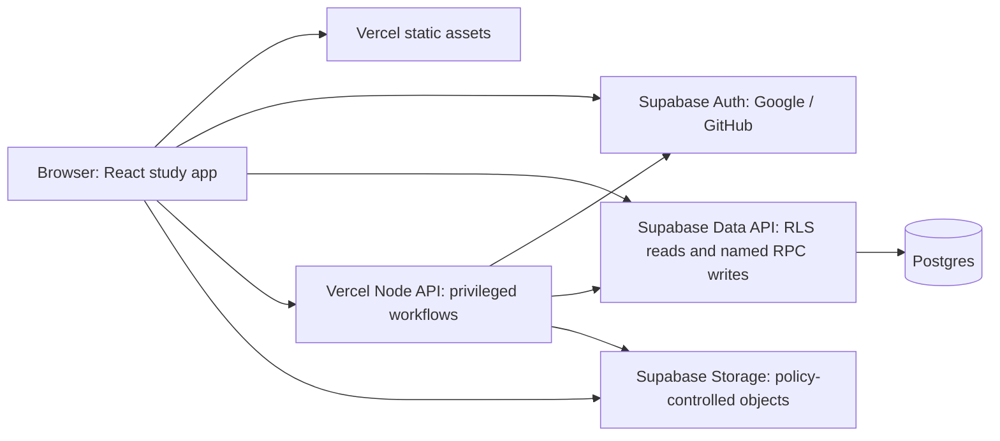

# 02 — System architecture and boundaries

## Runtime topology

Public readers fetch published course data with the publishable key. Signed-in learners read only their own records and write through bounded database functions. Server-only administrative credentials are used only after identity and authorization checks. Uploads go directly to private Storage; validation functions receive an operation ID, not a client-selected URL. Runtime application code never reads the owner's local course directory.

## Modules and authority

| Module | Owns | Must not own |
| --- | --- | --- |
| Catalogue/content | Course routes, version-pinned lessons, references and search | Private answers or completion |
| Learning | Enrollment, progress, notes, reflection, resume | Authoring or roles |
| Identity | Session lifecycle, account UI and deletion | Custom password storage |
| Publishing | Bundle validation, draft preview, publication and rollback | Executing uploaded code |
| Demonstrations | Pure models and event-driven renderers | Learner Python execution |
| UI system | Tokens, accessible primitives, study components | Database authorization |
| Operations | Config, telemetry, migrations and backup tooling | Public admin credentials |

The database is authoritative for ownership, revisions, status transitions and timestamps. Browser validation improves feedback but cannot establish permissions. Server functions orchestrate external operations; atomic data changes happen inside one SQL transaction.

## Representative read path

1. Resolve course slug/alias to stable course ID and published active version.
2. Pin that version ID in the course session; load its outline.
3. Fetch selected lesson and references by the same version ID.
4. Fetch learner records separately with user-scoped query keys.
5. On focus/return, check whether the active version changed. Offer an update notice; preserve drafts before switching the whole course session.
6. Removed lesson notes remain available in an archived-work view keyed by stable IDs.

No private data goes into public CDN payloads. Versioned public content may be cached; personal API responses use `Cache-Control: no-store`. No service worker/offline content cache in release one. Query keys include environment, course, version and, for private data, user ID. Auth changes cancel pending requests and remove old user caches.

## Initial capacity and service targets

These are proposed acceptance targets, not measured guarantees:

- 100 monthly active learners; stress-test 20 concurrent active sessions, including five note editors. Monthly activity is not concurrent traffic.
- One course at launch, 30 lessons; model and test at least two courses with different structures.
- At one note save per second, five continuous editors generate five write calls/second. Debounce and coalescing reduce typical load; do not count on debounce for authorization or quota enforcement.
- Warm note save p95 below 1.5 seconds from staging in the chosen nearby region; visible pending feedback immediately. Measure network and cold-start conditions separately.
- Initial mobile route JavaScript target at most 250 KiB gzip excluding lazy demos/highlighting; total initial transfer target below 750 KiB including fonts. Measure rather than assume.
- Largest allowed upload validation must fit within configured memory/time with at least 2x measured duration headroom. If it fails, lower documented limits or redesign the job before launch.
- Initial recovery objectives: at most 24 hours of data loss after a disaster, restore within one working day. These become promises only after a successful scheduled backup and restore rehearsal.

## Consistency and failure rules

Private note writes require compare-and-swap revisions. Progress actions are explicit and idempotent. Publication switches one database pointer after assets are ready. Content snapshots are immutable once published. Imports replace selected records in a transaction, not a loop of browser requests.

A failed read shows retry and preserves local work. A failed save remains visibly unsaved. A response timeout means outcome unknown: query operation status or retry with the same mutation ID. Never infer that timeout means rollback. Storage upload and SQL commit are separate; orphan cleanup is a documented operation with reference checks.

## Deliberate boundaries

No live multi-user editing, automatic grading, IDE, AI provider or background email system. UI diagrams are trusted application code; uploaded content can select registered demo IDs only. Keep search course-scoped and derived from public content. Large-scale full-text infrastructure is unnecessary until measurements show the client-side course index is too costly.
